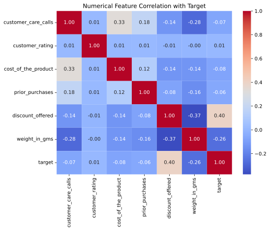
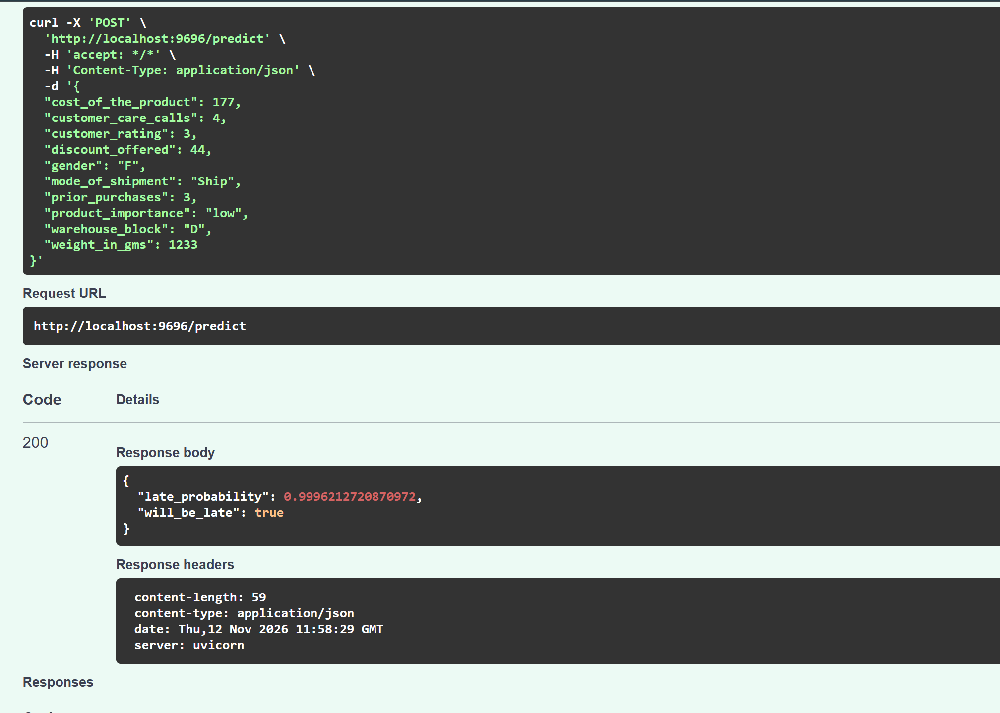

# E-Commerce Delivery Prediction (ML Zoomcamp Midterm Project)

## 1. Problem Statement
*(Evaluation: Problem description)*

In the fast-paced e-commerce industry, late package deliveries lead to severe customer dissatisfaction, increased customer support tickets, and higher operational costs. 

**The Problem:** We need to identify which shipments are at high risk of arriving late.
**The Solution:** This project builds a machine learning classification model to predict whether a shipment will arrive on time or be delayed based on logistical and product data (e.g., warehouse block, shipment mode, product weight, and discounts). By accurately predicting delivery delays in advance, e-commerce companies can proactively notify affected customers, reroute high-risk packages, and optimize supply chain bottlenecks.

## 2. Dataset Description
The dataset (`Train.csv`) is included directly in this repository for full reproducibility. It contains customer, product, and logistical information for thousands of previous orders.

* **Target Variable:** `Reached.on.Time_Y.N` (1 = Late, 0 = On Time)
* **Key Features:** 
  * `Warehouse_block`: The company warehouse block (A, B, C, D, F)
  * `Mode_of_Shipment`: Ship, Flight, or Road
  * `Customer_care_calls`: Number of calls made for shipment tracking
  * `Cost_of_the_Product`: Cost in US Dollars
  * `Prior_purchases`: Number of prior purchases made by the customer
  * `Discount_offered`: Discount offered on the specific product
  * `Weight_in_gms`: Weight of the product in grams

## 3. Exploratory Data Analysis (EDA)
*(Evaluation: EDA)*

Extensive Exploratory Data Analysis was performed in `notebook.ipynb` to understand data distributions, ranges, and feature interactions:
* **Data Cleaning:** Checked for missing values, duplicates, and anomalous outliers (min/max ranges).
* **Target Distribution:** Analyzed the class balance between on-time and late deliveries to establish a baseline.
* **Feature Importance:** Evaluated numerical features using correlation matrices and categorical features using Mutual Information scores to identify the strongest predictors of delivery delays (notably `Discount_offered` and `Weight_in_gms`).

### Feature Correlation Heatmap


## 4. Modeling Approach & Metrics
*(Evaluation: Model training)*

Multiple machine learning models were trained, evaluated, and compared to find the best performer for this classification task:
1. **Logistic Regression** (Baseline model)
2. **Decision Tree Classifier**
3. **Random Forest Classifier** 
4. **XGBoost Classifier**

**Hyperparameter Tuning & Selection:** 
The models were evaluated using Accuracy and ROC-AUC scores. The tree-based models (Random Forest and XGBoost) underwent extensive hyperparameter tuning (adjusting `max_depth`, `learning_rate`, `n_estimators`, and `min_samples_leaf`) to prevent overfitting. 

**Final Model:**
The tuned **XGBoost** model provided the best balance of performance and generalization. It was selected as the final model, trained on the full dataset, and exported using `pickle` as `model.bin`.

## 5. Dependency and Environment Management
*(Evaluation: Dependency and environment management)*

This project uses `requirements.txt` for dependency management. 

**To set up the virtual environment locally:**
```bash
# 1. Create a virtual environment
python -m venv .venv

# 2. Activate the environment
# On Windows:
.venv\Scripts\activate
# On macOS/Linux:
source .venv/bin/activate

# 3. Install required dependencies
pip install -r requirements.txt
```

## 6. How to Run Locally (Reproducibility)
*(Evaluation: Exporting notebook to script & Reproducibility)*

The exploratory logic was refactored into a reproducible training script (`train.py`), and the deployment logic is contained in `serve.py`. Because `Train.csv` is committed to the repository, you can execute the entire pipeline without downloading external data.

**1. Train the model (Optional, as `model.bin` is provided):**
```bash
python train.py
```

**2. Start the FastAPI Web Service:**
```bash
uvicorn serve:app --host 0.0.0.0 --port 9696
```
The local API documentation will be available at: `http://localhost:9696/docs`

## 7. Containerization (Docker)
*(Evaluation: Containerization)*

The application is fully containerized. A `Dockerfile` is provided to build and run the service without needing to install Python or dependencies on your local machine.

**Build the Docker Image:**
```bash
docker build -t ecommerce-delivery-api .
```

**Run the Docker Container:**
```bash
docker run -it --rm -p 9696:9696 ecommerce-delivery-api
```
The Dockerized API will be available at: `http://localhost:9696/docs`

## 8. Cloud Deployment (Render)
*(Evaluation: Cloud deployment)*

The containerized FastAPI service has been deployed to the cloud using **Render** and is currently live.

* **Live API Documentation (Swagger UI):** [https://ecommerce-delivery-prediction-1ns3.onrender.com/docs](https://ecommerce-delivery-prediction-1ns3.onrender.com/docs)
* *(Note: Because it is hosted on Render's free tier, the container spins down after 15 minutes of inactivity. The very first request may take ~60 seconds to wake the server).*

### Cloud Prediction Screenshot
Below is a screenshot of the live cloud API successfully returning a prediction via Swagger UI:



### Cloud Prediction Example (cURL)
You can also test the live cloud API directly from your terminal using `curl`:

```bash
curl -X POST "[https://ecommerce-delivery-prediction-1ns3.onrender.com/predict](https://ecommerce-delivery-prediction-1ns3.onrender.com/predict)" \
     -H "Content-Type: application/json" \
     -d '{
           "warehouse_block": "D",
           "mode_of_shipment": "Ship",
           "customer_care_calls": 4,
           "customer_rating": 3,
           "cost_of_the_product": 177,
           "prior_purchases": 3,
           "product_importance": "low",
           "gender": "F",
           "discount_offered": 44,
           "weight_in_gms": 1233
         }'
```
**Expected Response:**
```json
{
  "late_probability": 0.9996212720870972,
  "will_be_late": true
}
```

---

## 9. Author
* **Ashutosh Kumar** 
* **LinkedIn:** [www.linkedin.com/in/ashuzzz151](https://www.linkedin.com/in/ashuzzz151)